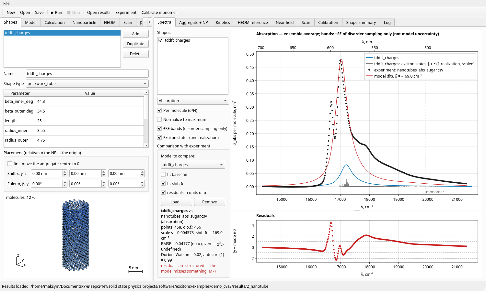
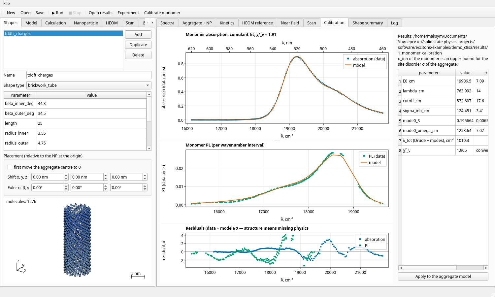
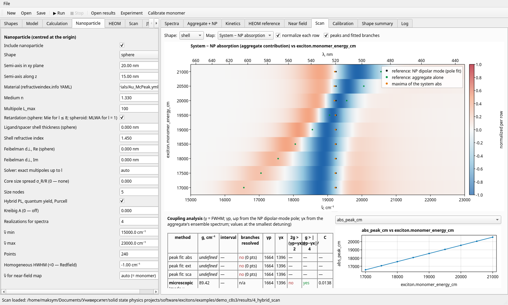
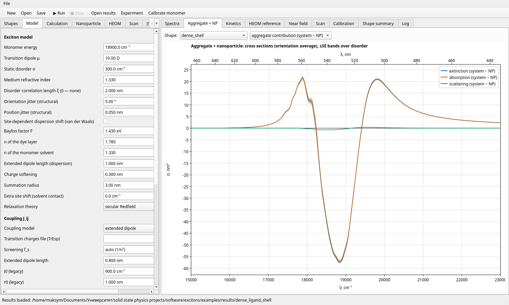
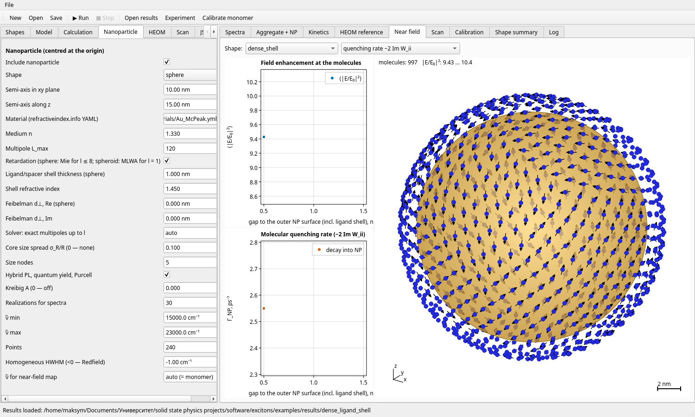
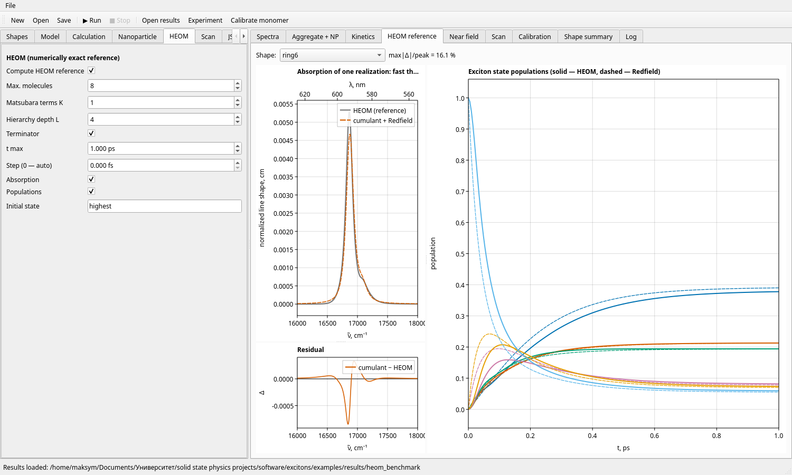
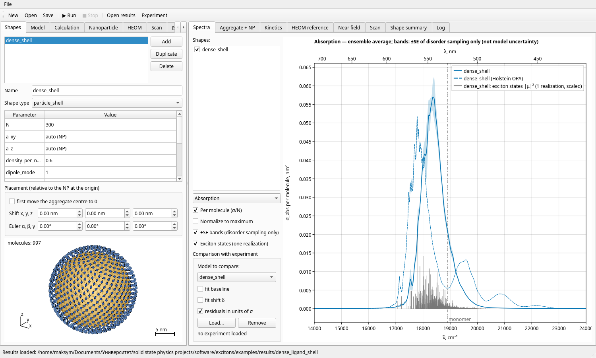
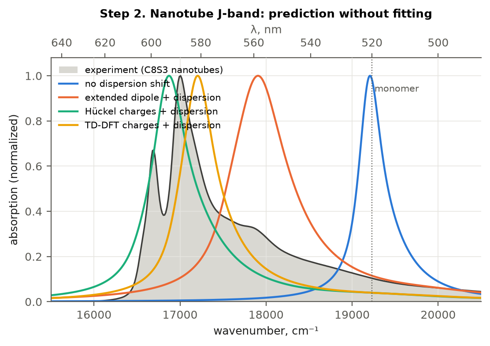

# SSP Nano

**Exciton spectra of molecular aggregates and plasmon–exciton hybrids — a C++20 / Qt 6 modelling toolkit.**

SSP Nano calculates absorption and fluorescence spectra, exciton kinetics and quantum yields of molecular J- and
H-aggregates of arbitrary shape, alone or next to a plasmonic nanoparticle (a sphere with a ligand shell, or a
spheroid). Model parameters are calibrated on measured monomer spectra, and the predictions are compared with
experiment, with residual analysis built in.



> 📖 **Illustrated guide with formulas, code and an interactive map of the program:** [`docs/index.html`](docs/index.html)
> (open it in a browser, or enable GitHub Pages for the `docs/` folder).
> Русская версия описания проекта: [README.ru.md](README.ru.md).

---

## Contents

- [What it can do](#what-it-can-do)
- [Gallery](#gallery)
- [Methods and formulas](#methods-and-formulas)
- [Validation](#validation)
- [Example study: the C8S3 nanotube](#example-study-the-c8s3-nanotube)
- [Get it running](#get-it-running)
- [Build from source](#build-from-source)
- [Configuration](#configuration)
- [Command-line tools](#command-line-tools)
- [Roadmap](#roadmap)
- [Repository layout](#repository-layout)
- [Data and credits](#data-and-credits)

---

## What it can do

| Area | Capability | Status |
|---|---|---|
| **Structures** | 15 parametric aggregate shapes (chains, rings, tubes, helices, sheets, a molecular shell on a nanoparticle, a seamless double-walled "brickwork" tube) | ✅ |
| **Excitons** | Frenkel Hamiltonian; couplings: point dipole, extended dipole, atomic transition charges (TrEsp) | ✅ |
| | Disorder: uncorrelated, spatially correlated, structural (orientation and position jitter) | ✅ |
| | Environment-dependent dispersive (van der Waals) site-energy shifts | ✅ |
| **Line shapes** | Second-order cumulant line shapes for a Drude bath plus Brownian vibrational modes | ✅ |
| | Vibronic absorption: Holstein model, one-particle approximation | ✅ |
| **Dynamics** | Secular Redfield and modified Redfield rates, population kinetics, steady-state fluorescence | ✅ |
| | HEOM reference (numerically exact) for small aggregates | ✅ |
| **Nanoparticles** | Mie theory (sphere, coated sphere); quasi-static multipoles for spheres and spheroids | ✅ |
| | Ligand/spacer shell, Feibelman d⊥ surface response, Kreibig size damping, size distribution | ✅ spheres |
| **Hybrids** | Linear response of aggregate + nanoparticle: extinction, absorption, scattering | ✅ |
| | Collective coupling strength *g*, strong-coupling criteria, coupled-oscillator analysis | ✅ |
| | Decay rates near the particle: Purcell factor, quenching, quantum yield, hybrid fluorescence | ✅ |
| | Fast solver for ~10³ molecules (low multipoles exact via Woodbury, high multipoles diagonal) | ✅ |
| **Calibration** | Joint fit of monomer absorption and fluorescence; transition dipole from the extinction integral; radiative lifetime | ✅ |
| | Transition charges from a geometry (Hückel) or from TD-DFT (PySCF helper script) | ✅ / 🟡 |
| **Workflow** | Parameter scans over any config key; comparison with experiment with residual diagnostics; CSV output | ✅ |
| **Not yet** | Raman and Brillouin spectra, 2D / pump–probe spectra, vibronic fluorescence, uncertainty budget, Bayesian calibration, atomistic (MD) structures, arbitrary particle shapes | 🔜 |

✅ implemented and tested · 🟡 partly · 🔜 planned

---

## Gallery

| | |
|---|---|
|  **Monomer calibration** — data, model, residuals, parameters with errors |  **Parameter scan** — an exciton tuned across the plasmon of a gold sphere |
|  **Aggregate + nanoparticle** — contribution of the molecular layer to the cross sections |  **Near field** — enhancement, quenching and quantum yield per molecule |
|  **HEOM reference** — fast theory against the numerically exact result |  **Spectra** — ensemble average with error bands, exciton sticks, vibronic model |

---

## Methods and formulas

Units throughout: energies in cm⁻¹, lengths in nm, dipoles in debye. The full derivations, the code that implements
each formula and interactive illustrations are in the [guide](docs/index.html).

### Exciton Hamiltonian

$$H=\sum_n\left(E_0+\delta_n+\Delta_n\right)|n\rangle\langle n|+\sum_{n\neq m}J_{nm}\,|n\rangle\langle m|$$

$E_0$ is the monomer transition energy, $\delta_n$ the static disorder, $\Delta_n$ the dispersive shift, $J_{nm}$ the
excitonic coupling. Three coupling models are available:

$$J^{\text{dip}}_{nm}=f_s\,C\,\mu^2\,\frac{\hat\mu_n\cdot\hat\mu_m-3(\hat\mu_n\cdot\hat r)(\hat\mu_m\cdot\hat r)}{r^3},\qquad C=5.034\ \text{cm}^{-1}\,\text{nm}^3\,\text{D}^{-2}$$

$$J^{\text{TrEsp}}_{nm}=f_s\,C\sum_{a\in n}\sum_{b\in m}\frac{q_a q_b}{|\mathbf r_a-\mathbf r_b|}$$

(the extended dipole is the two-charge special case; $f_s\approx 1/n^2$ is the screening factor).

### Dispersive site-energy shifts

Following Megow *et al.* (2015), the van der Waals interaction with the surrounding molecules shifts each site energy:

$$\Delta_m=Q\sum_k V_{mk}^2,\qquad V_{mk}=\sum_{a,b}\frac{q_a q_b}{\sqrt{r_{ab}^2+a_0^2}}$$

$Q$ is calibrated so that randomly oriented molecules at the same positions reproduce the continuum (Bayliss)
shift $-F\,(n^2-1)/(2n^2+1)$.

### Bath and line shapes

$$J(\omega)=\frac{2\lambda\gamma\,\omega}{\omega^2+\gamma^2}+\sum_k\frac{2S_k\omega_k^3\gamma_k\,\omega}{(\omega_k^2-\omega^2)^2+\gamma_k^2\omega^2}$$

$$g(t)=\frac1\pi\int_0^\infty\frac{J(\omega)}{\omega^2}\left[\coth\frac{\beta\omega}{2}\,(1-\cos\omega t)+i(\sin\omega t-\omega t)\right]d\omega$$

$$\sigma_{\text{abs}}(\omega)=P\,\omega\sum_n|\mu_n|^2\,\frac1\pi\,\mathrm{Re}\int_0^\infty e^{\,i(\omega-\varepsilon_n)t-s_n g(t)-\Gamma_n t/2}\,dt$$

with the participation factor $s_n=\sum_i c_{in}^4$ (exchange narrowing) and $\Gamma_n$ the population decay rate of
exciton $n$. Fluorescence uses $g^*(t)$ and the reorganisation shift $2 s_n\lambda$.

### Relaxation

Secular Redfield rates between exciton states:

$$k_{n\to m}=\sum_i c_{in}^2c_{im}^2\,\tilde C(\varepsilon_n-\varepsilon_m),\qquad \tilde C(\omega)=\frac{2J(|\omega|)\,\mathrm{sgn}\,\omega}{1-e^{-\beta\omega}}$$

Modified Redfield theory (diagonal exciton–phonon coupling treated non-perturbatively) and HEOM (reference) are also
available.

### Nanoparticle and hybrid response

Multipole response of a sphere in the quasi-static limit, dressed with exact Mie coefficients for $l\le 8$:

$$\hat D_l=-\frac{l\,(\varepsilon-\varepsilon_m)}{l\,\varepsilon+(l+1)\,\varepsilon_m},\qquad \alpha=-\hat D_1R^3$$

A ligand shell and the Feibelman parameter $d_\perp$ enter through the boundary conditions of a layered sphere. The
molecules and the particle are solved together:

$$\alpha_{\text{tot}}(\omega)=\alpha_{\text{NP}}(\omega)+c\,M^{\mathsf T}\left[H_{\text{eff}}(\omega)-\omega\right]^{-1}M,\qquad H_{\text{eff}}=H+W(\omega)$$

$$\sigma_{\text{ext}}=4\pi k\,\mathrm{Im}\,\tfrac13\mathrm{Tr}\,\alpha_{\text{tot}},\qquad \sigma_{\text{sca}}=\tfrac{8\pi}{3}k^4\,\tfrac13\sum_{ab}|\alpha_{ab}|^2$$

$W$ is the interaction of the transition dipoles through the field induced in the particle; $M$ contains the
local-field factors.

### Decay near the particle

$$\Gamma_{\text{tot}}=\Gamma_0\,\big|L^{\mathsf T}\hat\mu\big|^2+\Gamma_{\text{abs}},\qquad \mathrm{QY}=\frac{\Gamma_0\,|L^{\mathsf T}\hat\mu|^2}{\Gamma_{\text{tot}}+\Gamma_{\text{nr}}}$$

### Strong coupling

$$\omega_\pm=\frac{\omega_p+\omega_x}{2}-\frac{i(\gamma_p+\gamma_x)}{4}\pm\sqrt{g^2+\left[\frac{\omega_p-\omega_x}{2}-\frac{i(\gamma_p-\gamma_x)}{4}\right]^2}$$

Criteria reported by the program: visible splitting $2g>(\gamma_p+\gamma_x)/2$, anticrossing $g>|\gamma_p-\gamma_x|/4$,
cooperativity $C=4g^2/\gamma_p\gamma_x$. The coupling $g$ is obtained microscopically from the pole of the dipolar
plasmon mode, without fitting peaks.

### Calibration on the monomer

$$\mu^2=\frac{1}{P}\int\frac{\sigma(\tilde\nu)}{\tilde\nu}\,d\tilde\nu,\qquad \Gamma_{\text{rad}}=\frac{n\,\omega^3\mu^2}{3\pi\varepsilon_0\hbar c^3}$$

Absorption and fluorescence are fitted together (Levenberg–Marquardt, start from spectral moments, multi-start).

---

## Validation

61 automated tests (41 exciton/hybrid, 20 plasmonics). Each block is checked against an independent reference:

| Block | Reference | Agreement |
|---|---|---|
| Line shapes | analytic Drude *g(t)*, detailed balance (KMS), HEOM for a monomer | < 1 % |
| Redfield kinetics | Boltzmann equilibrium; HEOM for a dimer | 0.03 in population |
| Modified Redfield | Redfield limit; detailed balance; HEOM at λ ≈ J | 3 %; 0.5 %; closer than Redfield |
| Layered sphere | homogeneous limits up to *l* = 60; Gersten–Nitzan series to *l* = 90 | 10⁻⁶ |
| Aggregate + NP | transparent particle → bare aggregate spectrum | < 1 % |
| Collective coupling *g* | analytic Drude sphere | 2 % |
| Decay near a gold sphere | exact Mie theory for a dipole | R ≤ 10 nm: 1–3 % (total), ≤ 10 % (radiative) |
| Fast solver | exact solver, 300 molecules | 0.2–0.7 % |
| Monomer fit | synthetic spectra with known parameters | within 1–2 σ |
| Gold extinction | supplier datasheets (5–50 nm) | 0.85–1.07 with size damping |

**Known limits.** Decay rates lose accuracy for particles with R ≳ 20 nm (7–40 %). Spheroids have no ligand shell.
The width of a J-band depends on the disorder in the aggregate, which is an input, not a prediction. Parameter
uncertainties are not yet propagated to the results.

---

## Example study: the C8S3 nanotube

A complete worked example lives in [`software/excitons/examples/demo_c8s3`](software/excitons/examples/demo_c8s3):
calibrate the monomer on its absorption and fluorescence, then **predict** the J-band of the double-walled nanotube
with no fit to the aggregate spectrum.



| Model | Peak, cm⁻¹ | Deviation |
|---|---|---|
| TD-DFT charges, no dispersion shift | 19 208 | +2 202 |
| Extended dipole + dispersion | 17 907 | +901 |
| Hückel charges + dispersion | 16 872 | −135 |
| **TD-DFT charges + dispersion** | **17 207** | **+200** |
| Experiment | 17 007 | — |

The red shift of the J-band comes mostly from the dispersive interaction with the environment, not from the
excitonic coupling. The report with all four steps: [`docs/demo`](docs/demo).

---

## Get it running

**Windows.** Take `ssp-windows-x64.zip` (from the Releases page once a release is published, or build it — see below), extract everything to a
folder and start `ssp_gui.exe`. The package contains all libraries and the examples.

**macOS / Linux.** Build from source (below), then start `ssp_gui`.

First steps in the GUI: **Open** `examples/notebook_demo.json` → **Run** (F5) → look at the **Spectra** tab. Step-by-step
procedures are in the operating instructions:
[`docs/demo/SSP_Nano_Operating_Instructions_STE100.docx`](docs/demo/SSP_Nano_Operating_Instructions_STE100.docx).

---

## Build from source

Requirements: a C++20 compiler, CMake ≥ 3.24, Qt 6.5+ (Widgets, Concurrent, Svg), Eigen 3.4+, FFTW 3, optionally
OpenMP and GoogleTest.

### Linux

```bash
# Arch: sudo pacman -S cmake ninja eigen fftw qt6-base qt6-svg gtest
# Debian/Ubuntu (needs Qt ≥ 6.5): sudo apt install cmake ninja-build libeigen3-dev libfftw3-dev qt6-base-dev qt6-svg-dev libgtest-dev
cd software
scripts/build.sh
ctest --test-dir build
build/gui/ssp_gui
```

### macOS

Needs the Xcode command-line tools and [Homebrew](https://brew.sh).

```bash
xcode-select --install
cd software
bash packaging/macos/build_macos.sh
open packaging/out/ssp-macos-$(uname -m)/ssp_gui.app
```

The script installs the dependencies with Homebrew, builds everything, bundles Qt into `ssp_gui.app`, signs it ad hoc
and writes `packaging/out/ssp-macos-<arch>.zip`. The app has no Apple developer signature: on another Mac, right-click
→ **Open** on first launch. *The macOS script has not been exercised on real hardware yet — please report problems.*

### Windows

The tested route is a cross-build in Docker (works on Linux, macOS and Windows with WSL 2):

```bash
cd software
packaging/windows/build_windows.sh
```

Result: `packaging/out/ssp-windows-x64.zip` (programs, Qt and runtime DLLs, examples). The build uses Fedora's
MinGW-w64 toolchain and Qt 6; FFTW is compiled from source inside the container.

Native build with [MSYS2](https://www.msys2.org) (UCRT64 shell) — *not tested yet*:

```bash
pacman -S mingw-w64-ucrt-x86_64-{gcc,cmake,ninja,qt6-base,qt6-svg,eigen3,fftw,pkgconf}
cd software
cmake -S . -B build -G Ninja -DCMAKE_BUILD_TYPE=Release -DSSP_BUILD_TESTS=OFF
cmake --build build
windeployqt6 build/gui/ssp_gui.exe
```

### Continuous integration

[`.github/workflows/build.yml`](.github/workflows/build.yml) builds the macOS (Apple Silicon and Intel) and Windows
packages on demand (**Actions → build → Run workflow**) or when a `v*` tag is pushed.

---

## Configuration

A calculation is described by one JSON file. Unknown keys are errors (protection against typos); keys starting with
`_` are comments. Paths are relative to the config file. Everything can be edited in the GUI; the **JSON** tab shows
the same file.

```json
{
  "output_dir": "results/my_run",
  "configurations": [
    { "name": "tube", "geometry_type": "brickwork_tube", "geometry_params": { "length": 25 } }
  ],
  "exciton": {
    "monomer_energy_cm": 19906, "transition_dipole_D": 11.4, "disorder_sigma_cm": 60, "n_medium": 1.33,
    "coupling":   { "model": "transition_charges", "charges_file": "data/tresp.txt", "screening": 0.32 },
    "dispersion": { "enabled": true, "F_eV": 1.43, "n_aggregate": 1.78, "use_coupling_charges": true }
  },
  "bath": { "type": "drude_lorentz", "lambda_cm": 764, "cutoff_cm": 573, "temperature_K": 295,
            "modes": [ { "omega_cm": 1259, "huang_rhys": 0.196, "gamma_cm": 30 } ] },
  "spectrum": { "wmin_cm": 14500, "wmax_cm": 21500, "nw": 1400 },
  "ensemble": { "min_realizations": 20, "max_realizations": 400, "rel_tolerance": 0.01 }
}
```

| Section | What it sets | Main keys |
|---|---|---|
| `configurations[]` | the aggregates to calculate | `name`, `geometry_type`, `geometry_params`, `placement` (`shift_nm`, `euler_deg`, `center`) |
| `exciton` | molecule and disorder | `monomer_energy_cm`, `transition_dipole_D`, `disorder_sigma_cm`, `disorder_corr_length_nm`, `orientation_jitter_deg`, `position_jitter_nm`, `relaxation` (`redfield` \| `modified_redfield`) |
| `exciton.coupling` | excitonic coupling | `model` (`point_dipole` \| `extended_dipole` \| `transition_charges` \| `legacy_J0`), `screening`, `dipole_length_nm`, `charges_file` |
| `exciton.dispersion` | dispersive site shifts | `enabled`, `F_eV`, `n_aggregate`, `n_solvent`, `softening_nm`, `cutoff_nm`, `charges_file` / `use_coupling_charges` |
| `bath` | spectral density | `type`, `lambda_cm`, `cutoff_cm`, `temperature_K`, `modes[]` (`omega_cm`, `huang_rhys`, `gamma_cm`) |
| `decay`, `pump` | emission | `monomer_lifetime_ns`, `nonradiative_ps`; `type` (`oscillator_strength` \| `laser`), `excitation_cm` |
| `spectrum`, `ensemble` | numerics | `wmin_cm`, `wmax_cm`, `nw`, `t_max_ps`; `min_realizations`, `max_realizations`, `rel_tolerance`, `seed` |
| `dynamics` | population kinetics | `enabled`, `t_max_ps`, `n_times`, `initial` (`brightest` \| `highest` \| `pump`) |
| `nanoparticle` | the particle | `enabled`, `shape` (`sphere` \| `prolate` \| `oblate`), `semi_axis_xy_nm`, `semi_axis_z_nm`, `material_file` or `drude`, `n_medium`, `l_max`, `shell_thickness_nm`, `shell_n`, `d_perp_nm`, `kreibig_A`, `size_sigma_rel`, `fast_l`, `emission` |
| `holstein` | vibronic absorption | `enabled`, `omega_cm`, `huang_rhys`, `nu_max` |
| `heom` | exact reference | `enabled`, `depth`, `matsubara`, `max_sites`, `t_max_ps` |
| `scan` | parameter scan | `enabled`, `parameter` (any JSON path), `from`, `to`, `steps`, `also_set` |
| `monomer_fit` | calibration run | `absorption_file`, `emission_file`, units, `absolute_extinction`, `start`, `fit` |

Geometry types (`ssp_aggregate --list-geometries` prints their parameters): `linear_chain`, `ring`, `elliptic_ring`,
`cylinder`, `double_wall_tube`, `elliptic_tube`, `helix`, `ribbon_2d`, `brick_layer_sheet`, `stacked_rings`,
`tube_radial_disorder`, `tube_variable_pitch`, `tapered_tube`, `particle_shell`, `brickwork_tube`.

Results are plain CSV files with a commented header (units, provenance): `spectra.csv`, `observables.csv`,
`dynamics.csv`, `plexciton.csv`, `molecules_near_field.csv`, `hybrid_emission.csv`, `site_shifts.csv`,
`scan_*.csv`, `fit_*.csv`, `summary.csv`.

Ready-made examples in [`software/excitons/examples`](software/excitons/examples):

| File | Shows |
|---|---|
| `notebook_demo.json` | three tube shapes, absorption / fluorescence / kinetics |
| `heom_benchmark.json` | cumulant + Redfield against HEOM |
| `shell_scan.json` | a molecular shell on a gold sphere, exciton scanned across the plasmon |
| `dense_ligand_shell.json` | ~1000 molecules in ordered domains on gold with a ligand layer, size distribution, hybrid PL |
| `monomer_calibration.json` | calibration on (synthetic) monomer spectra |
| `demo_c8s3/` | the full C8S3 study on measured data, steps 1–4 |

---

## Command-line tools

```bash
ssp_aggregate config.json                                  # calculation (or a scan, or a calibration)
ssp_aggregate --list-geometries                            # shapes and their parameters
ssp_aggregate --huckel-tresp molecule.xyz charges.txt 1    # transition charges from a geometry
ssp_benchmark purcell Au.yml out.csv                       # decay rates: model vs exact Mie theory
ssp_benchmark extinction Au.yml out.csv                    # gold extinction vs datasheet values
ssp_gui config.json --run --screenshot shot.png            # scripted GUI (with QT_QPA_PLATFORM=offscreen)
```

---

## Roadmap

1. **Uncertainty budget** — propagate the spread of the inputs (F, n, μ, structure, bath) to band positions and widths.
2. **Band widths** — periodic boundary conditions along tubes, analysis of the contributions to the J-band width.
3. **Larger particles** — radiation of higher multipoles and retardation inside the particle; ligand shells on spheroids.
4. **Vibronic fluorescence** and two-particle states in the Holstein model.
5. **Quantum chemistry in the loop** — a general "geometry → TD-DFT → transition charges" pipeline (PySCF / NWChem).
6. **More spectroscopies** — Raman and Brillouin scattering, pump–probe and two-dimensional spectra.
7. **Bayesian calibration** with residual analysis and latent-variable discovery.
8. **Atomistic structures** — aggregates on particle surfaces from molecular dynamics.

---

## Repository layout

```
software/
  common/        units and constants
  plasmonics/    optical constants, Mie theory, layered sphere, quasi-static particle, dipole near a sphere
  excitons/      geometry, Hamiltonian, bath, line shapes, Redfield, HEOM, Holstein, hybrid response, calibration
    app/         config parser, runner, scans, calibration (shared by CLI and GUI)
    examples/    configs, bundled gold optical constants, the C8S3 demo
    tests/       GoogleTest suites
  gui/           Qt 6 Widgets interface (custom plots, 3D preview)
  validation/    ssp_benchmark
  packaging/     Windows (Docker) and macOS build scripts
  qc/            optional quantum-chemistry helpers (PySCF script, NWChem wrapper)
  data_fetch/    scripts that download open reference databases
docs/
  index.html     illustrated guide (formulas, code, program map)
  methods/       method notes (Russian)   reviews/  model audit   demo/  report, manual, figures
data/
  experiment/    processed open data used for calibration, with provenance
  results/       benchmark tables and calibration results
```

---

## Data and credits

The example study uses open data; please cite the original sources:

- S. Doria *et al.*, "Vibronic coherences in light harvesting nanotubes: unravelling the role of dark states",
  *J. Mater. Chem. C* (2022), doi:10.1039/d2tc00203e — data: Zenodo 10.5281/zenodo.7313810 (CC BY 4.0).
- A. V. Kuevda *et al.*, *J. Am. Chem. Soc.* **147**, 6171 (2025), doi:10.1021/jacs.4c17708 (CC BY 4.0) — monomer
  fluorescence digitised from Fig. 1c.
- A. S. Bondarenko *et al.*, "C8S3 molecular geometry and charge distributions", figshare (2020),
  doi:10.6084/m9.figshare.12369335 (CC BY 4.0).
- L. Kleine-Kleffmann *et al.*, *Angew. Chem.* (2023), doi:10.1002/anie.202314667 — data: Zenodo
  10.5281/zenodo.10066797 (CC BY 4.0).
- J. Megow *et al.*, *Phys. Chem. Chem. Phys.* **17**, 6741 (2015) — structure model and dispersion-shift theory.
- Optical constants of gold: refractiveindex.info (CC0) — McPeak *et al.* (2015), Johnson & Christy (1972).

Built with [Eigen](https://eigen.tuxfamily.org), [FFTW](https://www.fftw.org), [Qt](https://www.qt.io),
[GoogleTest](https://github.com/google/googletest); transition charges with [PySCF](https://pyscf.org).

## License

No license has been chosen yet. Until a `LICENSE` file is added, the code is published for review only.
